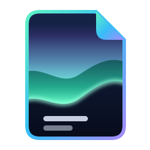
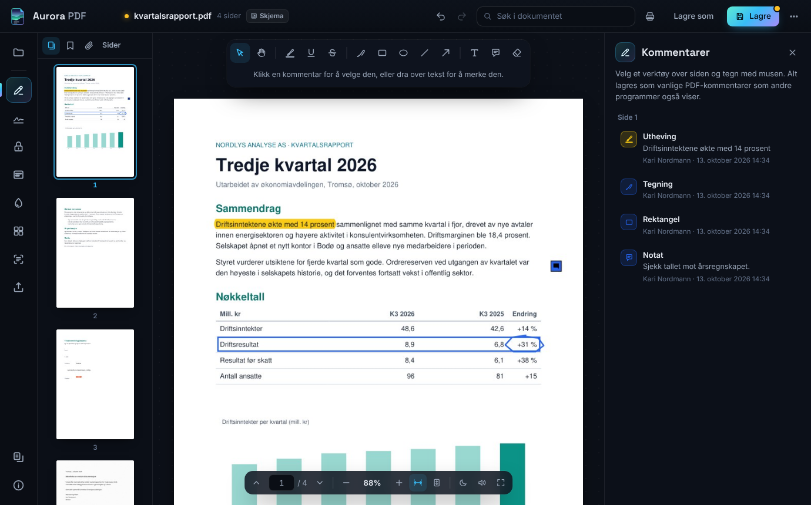
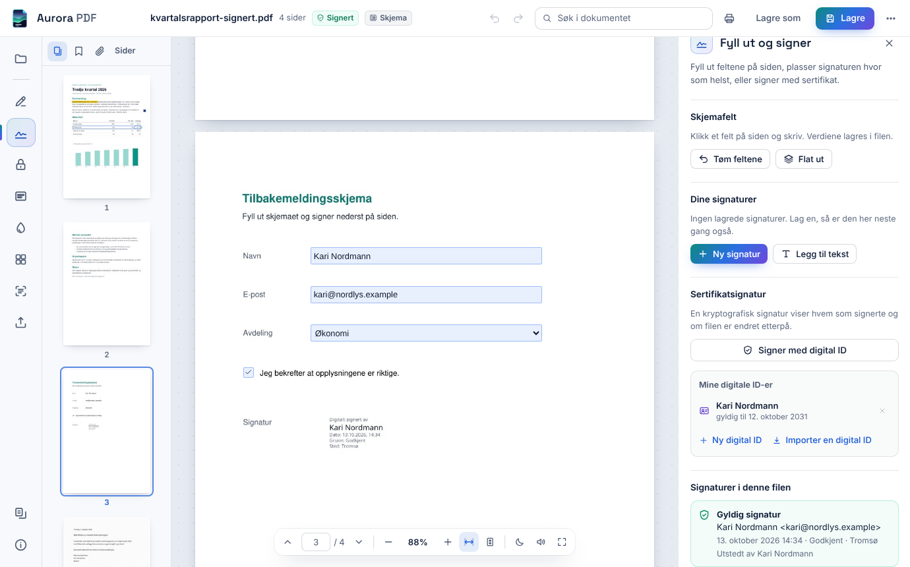
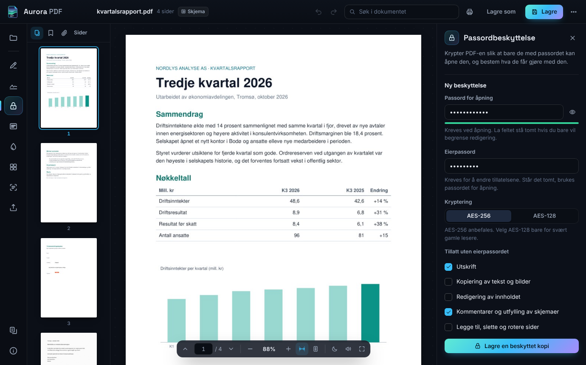
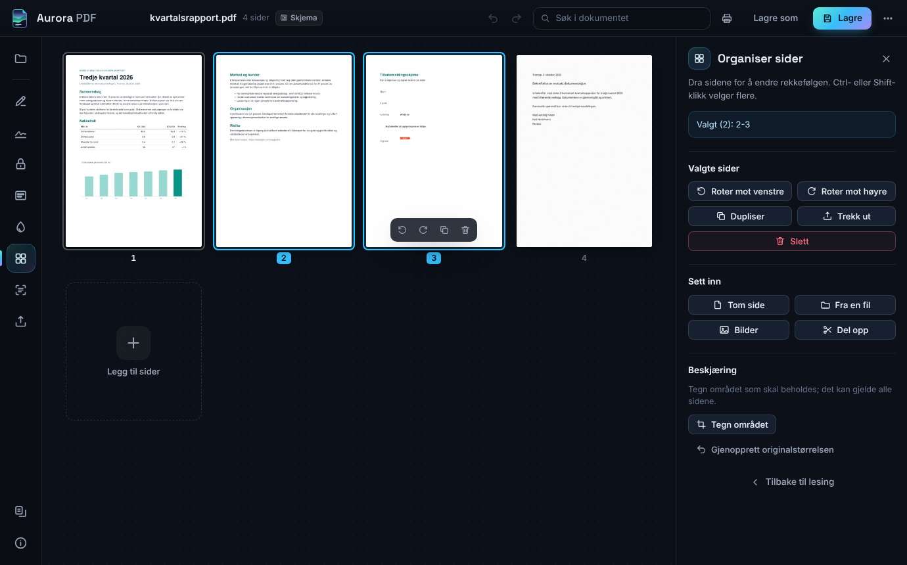
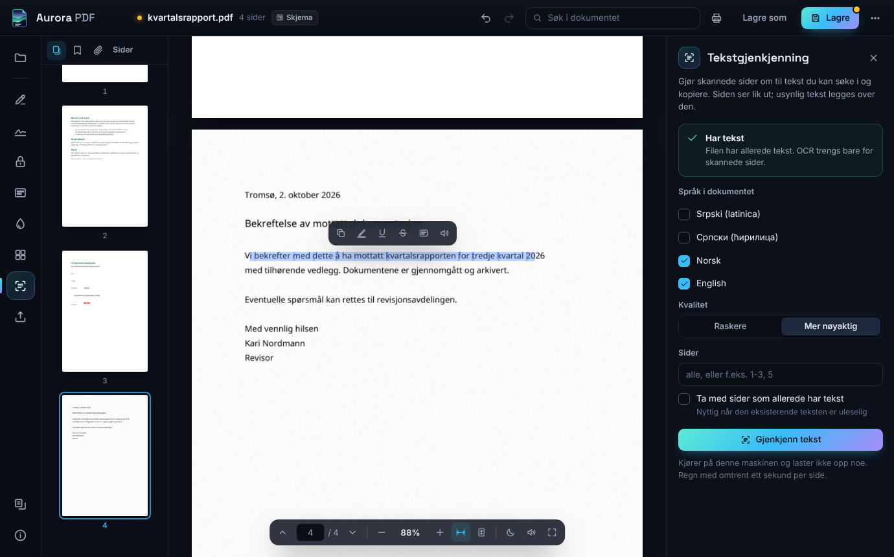

# AuroraPDF – en PDF-leser for Windows som låser, signerer og leser skannede sider

**Et skrivebordsprogram for å lese, kommentere, fylle ut, signere og passordbeskytte PDF-filer. Alt skjer på egen maskin, uten konto og uten opplasting.**

Et porteføljeprosjekt utenfor Power BI. Målet var et program for daglig bruk med de samme funksjonene som Adobe Acrobat Reader, der passordbeskyttelse og vannmerke var viktigst.

Programmet har 166 automatiske tester. 52 av dem styrer det ekte grensesnittet med mus og tastatur.



---

## Hva programmet gjør

| Område | Funksjoner |
|---|---|
| Lese | Sider og miniatyrer, zoom, søk med treffene markert, bokmerker, vedlegg, nattmodus, fullskjerm, opplesing, utskrift |
| Kommentere | Utheving, understreking, gjennomstreking, penn, rektangel, ellipse, linje, pil, tekstboks og notat. Kommentarene kan flyttes, endre størrelse og farge og slettes |
| Fylle ut og signere | Tekstfelt, avkrysningsbokser, radioknapper og valglister. Signatur som tegnes, skrives eller hentes fra et bilde. Sertifikatsignatur med egen digital ID, og kontroll av signaturene i filen |
| Beskytte | Passord for å åpne filen (AES-256 eller AES-128). Eierpassord med tillatelser for utskrift, kopiering, redigering, kommentarer og sider |
| Vannmerke | Tekst eller bilde, med vinkel og gjennomsiktighet, én gang eller gjentatt over hele siden. Topptekst og bunntekst med sidenummer, dato og filnavn |
| Sladde | Områder eller søketreff. Tekst, bildepunkter, kommentarer, skjemafelt og lenker under området blir fjernet fra filen |
| Sider | Ny rekkefølge ved å dra, rotere, duplisere, trekke ut, slette, sette inn tom side, en annen PDF eller bilder, dele opp og beskjære |
| OCR | Gjør skannede sider søkbare på norsk, engelsk og serbisk (latinsk og kyrillisk) |
| Eksport | Word (.docx), ren tekst, sider som PNG eller JPG, og bildene som ligger i filen |
| Annet | Slå sammen filer, dokumentinfo, komprimere store bilder, åpne bilder som PDF |

Grensesnittet finnes på norsk, engelsk og serbisk, med lyst og mørkt tema. Står temaet på automatisk, følger det innstillingen for apper i Windows.





---

## Slik er programmet bygd

```
main.py      starter den lokale serveren og vinduet
api.py       alt grensesnittet kan be om, én metode per handling
core/        PDF-motoren: arbeidskopi og angre, sider, kommentarer, signering, OCR og serveren
web/         grensesnittet: HTML, CSS og ni JavaScript-filer uten rammeverk
resources/   skriften Noto Sans og språkdata for OCR
scripts/     snarveier og PDF-registreringen i Windows
tests/       motoren og API-et med pytest, grensesnittet med Playwright (tests/e2e)
```

Motoren er PyMuPDF, som bygger på MuPDF. pyHanko lager og kontrollerer sertifikatsignaturene, cryptography lager nøklene til de digitale ID-ene, pdf2docx står for Word-eksporten, og Pillow koder sidebildene. Grensesnittet er vanlig HTML, CSS og JavaScript i et WebView2-vindu fra pywebview. Det har ikke noe byggesteg: filene i `web/` er de som kjører.

Koden er rundt 4 700 linjer Python, 4 100 linjer JavaScript og 1 500 linjer CSS. Testene er 3 600 linjer.

### Valg som er verdt å se på

**Grensesnittet henter alt over HTTP.** En lokal server på 127.0.0.1 med et tilfeldig token i adressen leverer sidebildene som JPEG og svarer på kall som JSON. pywebview brukes bare til vinduet, fildialogene, dra-og-slipp og lukking. Serveren kan også startes uten vindu (`main.py --serve`). Da kjører ende-til-ende-testene mot den samme koden som programmet bruker.

**Den åpne filen er en ukryptert arbeidskopi i minnet.** En passordbeskyttet fil åpnes med passordet og redigeres som andre filer. Beskyttelsen, med algoritme, passord og tillatelser, legges på igjen når filen lagres. Uten eierpassordet kan filen bare lagres som kopi, og kopien får de samme begrensningene.

**Bare sidene nær skjermen finnes i nettleseren.** Etter et hopp i et dokument på 400 sider er fire sider levende. De andre er tomme plassholdere med riktig størrelse. Under rask rulling hentes ingen bilder. De skarpe bildene lastes når rullingen stopper, og forespørsler for sider som har gått ut av skjermen, avbrytes. Etter en endring byttes bare miniatyren til siden som ble endret.

**Hver endring er ett angresteg.** Før en endring tas et øyeblikksbilde av arbeidskopien. Feiler endringen, rulles den tilbake. OCR over mange sider er også ett steg. Store øyeblikksbilder, for eksempel av et skannet dokument, venter i en midlertidig fil i stedet for i minnet.

**Word-eksporten går i en egen prosess.** PyMuPDF tåler ikke å brukes fra to tråder samtidig, så all bruk går gjennom én lås. Konverteringen til Word kan ta minutter. Den får en kopi av dokumentet og kjører i en egen prosess, så sidene lastes mens den jobber, og «Avbryt» stopper prosessen.

**Beskyttelsen følger med kopiene.** Sider som trekkes ut, deles opp eller komprimeres, får samme passord og tillatelser som dokumentet. En fil med begrensninger kan bare slås sammen med andre eller settes inn i et annet dokument av eieren, siden resultatet ikke får begrensningene med seg. Programmet spør derfor etter eierpassordet til den filen.

**Kommentarene er vanlige PDF-kommentarer.** Uthevinger, tegninger, figurer og notater lagres som standard PDF-annotasjoner, så andre PDF-lesere viser dem og kan redigere dem.

**En signert fil skrives ikke om uten advarsel.** Ctrl+S uten endringer lar filen være. Lagre som kopierer filen byte for byte. En ny sertifikatsignatur legges til som et tillegg på slutten av filen, så de signaturene som finnes fra før, er fortsatt gyldige. Bare når filen er endret, varsler programmet om at signaturene ikke lenger vil holde.

**Signaturen kan gå inn i feltet som finnes.** Klikker man på et tomt signaturfelt i et skjema, signerer programmet i det feltet og lager ikke et nytt ved siden av.

**Ingenting slettes for godt.** En digital ID som fjernes, flyttes til en egen mappe og kan importeres igjen. Eksport av sider og bilder overskriver aldri en fil som finnes; den nye filen får (2) i navnet. Avinstalleringen legger snarveiene i papirkurven.

**Ett stilark for begge temaene.** Alle fargene ligger i variabler. Det mørke temaet er standardverdiene, og det lyse overstyrer dem i én blokk. Tittellinjen i Windows får de samme fargene, og vinduet starter i riktig farge, så det ikke blinker mørkt før et lyst tema er lastet.

**Oversettelsene er testet.** De 528 tekstene i grensesnittet ligger i én tabell med tre språk. En test leser koden, finner hver tekstnøkkel som brukes, og feiler hvis en tekst mangler, ikke brukes, eller har ulike plassholdere på de tre språkene.

### Testing

| Fil | Tester | Dekker |
|---|---:|---|
| `tests/test_engine.py` | 57 | PDF-motoren: passord og tillatelser, vannmerke og topptekst på roterte sider, sideoperasjoner, kommentarer, skjemafelt, sladding, bokmerker og eksport |
| `tests/test_api.py` | 44 | Alle kall gjennom API-et: lagring, beskyttelse, signering, angre, feilkoder, jobber, fildialoger, HTTP-serveren, installasjonssjekken og at snarveiene har samme oppgavelinje-ID som vinduet |
| `tests/test_ocr_sign.py` | 9 | OCR med språkdataene som følger med, digitale ID-er, signering og endringer etter signering |
| `tests/test_i18n.py` | 4 | Oversettelsene |
| `tests/e2e/test_ui.py` | 52 | Grensesnittet, styrt med mus og tastatur |

Noen av testene:

- `test_protect_copy_and_reopen`: den beskyttede kopien krever passord, feil passord gir feilkode, og uten eierpassordet kan ikke sidene roteres
- `test_owner_unknown_forces_copy`: uten eierpassordet lagres endringer bare som kopi, og kopien beholder begrensningene
- `test_sign_protected_and_tamper`: signaturen er gyldig i en kryptert fil, og én endret byte gjør den ugyldig
- `test_counter_signature_keeps_the_first_one`: når en signert kontrakt signeres en gang til, er begge signaturene gyldige, også i en kryptert fil
- `test_failed_save_as_leaves_the_original_alone`: en lagring som feiler, gir ingen vei rundt eierpassordet
- `test_ocr_adds_invisible_text_in_place`: den gjenkjente teksten havner over ordet i bildet, også på roterte sider
- `test_redaction_removes_comments_fields_and_links_under_the_mark`: det sladdede nummeret finnes ikke noe sted i den lagrede filen, heller ikke i en utheving, et notat, et skjemafelt eller en lenke
- `test_failed_edit_rolls_back`: en endring som feiler, etterlater ingen spor
- `test_watermark_angle_is_visual`: vinkelen på vannmerket er den brukeren ser, også når siden er rotert
- `test_quick_successive_drawings_all_land`: fire figurer tegnet rett etter hverandre havner alle i filen
- `test_ctrl_s_saves_what_is_still_being_typed`: Ctrl+S med markøren fortsatt i et skjemafelt eller en tekstboks lagrer det som står der
- `test_link_leads_to_its_page_after_pages_are_inserted`: en lenke fører til riktig side også etter at sider er satt inn foran målet
- `test_long_document_keeps_only_nearby_pages_alive`: i et dokument på 240 sider er høyst tolv sider levende
- `test_theme_follows_windows_and_the_choice_is_remembered`: temaet følger Windows, og et tema valgt i menyen gjelder foran Windows og etter omstart

`python main.py --selftest` prøver hver del av motoren én gang på en midlertidig fil: visning, kryptering, vannmerke, OCR, signering, Word-eksport, serveren og WebView2. Installasjonen kjører den, og rapporten havner i `%APPDATA%\AuroraPDF\selftest.txt`.

### Ytelse

Målt med `tests/e2e/perf.py` i hodeløs Chromium, i en Linux-container med to prosessorkjerner. Tallene er fra tre kjøringer.

| Måling | Resultat |
|---|---:|
| Åpne et dokument på 400 sider, til første skarpe side | 480–606 ms |
| Jevn rulling, tid per bilde, median | 16,7 ms |
| Jevn rulling, tid per bilde, 95. persentil | 24–29 ms |
| Bildeforespørsler under rask rulling over rundt 60 sider | 0 |
| Hopp til side 351, til siden er skarp | 441–526 ms |

16,7 ms per bilde tilsvarer 60 bilder i sekundet.





---

## Installere og kjøre

```
1_INSTALLER.bat
```

Fila finner Python 3.11–3.14 eller tilbyr å installere 3.13 med winget. Så lager den `.venv`, installerer bibliotekene, kjører installasjonssjekken og legger snarveier på skrivebordet og i Start-menyen. Svares det J på spørsmålet om PDF-filer, kommer Aurora PDF med under «Åpne med» og i Standardapper, og Innstillinger åpnes på siden der det kan velges som standard. Det valget gjør brukeren selv, for Windows lar ikke et program gjøre seg til standard. Krever Windows 10 eller 11 med Microsoft Edge WebView2, som følger med Windows 11.

Resten står i `START_HER.md`.

---

## Feil som formet prosjektet

**Sidene gikk gjennom pywebview-broen.** Første versjon sendte hver side som PNG i en base64-streng gjennom broen mellom Python og JavaScript, med en ny streng for hvert zoomnivå. Ingenting ble bufret eller avbrutt, og sidene som var lastet, ble liggende i minnet. Versjon 2 henter sidene som vanlige JPEG-bilder fra den lokale serveren, med et revisjonsnummer i adressen, og bare sidene nær skjermen er lastet.

**JPEG-kodingen holdt låsen.** Et hopp til side 351 tok 2 057 ms før siden var skarp. All bruk av PyMuPDF går gjennom én lås, og MuPDF brukte rundt 150 ms på å kode hver side som JPEG inne i låsen. Nå tegnes siden under låsen på 10–15 ms, og Pillow koder bildet utenfor låsen på rundt 20 ms. Det samme hoppet tar nå 441–526 ms.

**Tegninger som forsvant.** Når to figurer ble tegnet rett etter hverandre, forsvant den andre. Etter hver endring hentes sidens informasjon på nytt, og i den korte pausen tok ikke siden imot musen. Ende-til-ende-testen `test_quick_successive_drawings_all_land` fant feilen. Siden beholder nå den gamle informasjonen til den nye er på plass.

**Et tomt signaturfelt gjorde filen «signert».** Programmet merket en fil som signert når skjemaet hadde signaturflagget satt. Et skjema med et tomt signaturfelt ga dermed advarsel om at lagring ville bryte signaturer som ikke fantes. Nå teller bare felt som faktisk er signert.

**Skjermbildene til denne README-en fant to feil.** Avkrysningsboksen i skjemaet lå 10 piksler under feltet sitt. Den fikk klassenavnet `check` etter felttypen, og det navnet ga allerede avkrysningsboksene i sidepanelet en toppmarg. Og etter sertifikatsignering sto knappen «Signer her» fortsatt oppå signaturen. Testene sjekket verdiene i feltene, men ikke hvor feltene lå. Begge feilene har nå egne tester.

**Gjennomgangen før publisering fant ti feil til.** Ctrl+S på en signert fil uten endringer skrev filen om og gjorde signaturen ugyldig. En ny signatur på en signert kontrakt gjorde den første ugyldig. Sladding fjernet teksten fra siden, men en utheving over den samme teksten beholdt ordene. Og knappen «Behold beskyttelsen» erstattet eierpassordet med passordet for å åpne filen. Alle ti er rettet, og hver av dem har en test som feiler hvis feilen kommer tilbake.

**Første kjøring på en ekte Windows-PC fant fem feil.** Hvert klikk på «Åpne» feilet. pywebview godtar bare bokstaver, tall og mellomrom i navnet på et filfilter, og filtrene het blant annet «Slike / Images». Testene svarer på fildialogene fra et skript og møtte aldri den kontrollen. Nå går hvert filter gjennom den samme kontrollen i en test. Avkrysningsboksen i skjemaet viste haken først etter et klikk et annet sted, fordi feltlaget ikke tegnes på nytt mens et felt har fokus. Panelet for sider viste slettede sider som valgt. I signaturpanelet for en kryptert fil sto årsak og sted som `<DecryptedObjectProxy object at …>`. Og når en signert fil ble lagret som kopi med eller uten passord, ble signaturen i kopien ugyldig uten varsel. Nå spør programmet først. Alle fem har tester.

**En kodegjennomgang fant åtte feil til.** Ctrl+S rett etter skriving i et skjemafelt meldte «Lagret», men filen manglet den nye teksten, fordi feltet sender teksten først når det mister fokus. Komprimering gjorde en signatur ugyldig uten å spørre. Sider som ble trukket ut av en passordbeskyttet fil, ble lagret uten passord, og en fil med begrensninger kunne slås sammen til en ny fil uten dem. En lenke kunne føre til feil side etter at sider var satt inn foran målet. Og en nedtrekksliste lagret navnet «Norway» der skjemaet ventet koden «NO». Alle åtte har tester. En ny gjennomgang av rettelsene fant i tillegg at 30 sider trukket ut av en fil på 350 kB ble nesten 10 MB, fordi hver side fikk sin egen kopi av skriften og logoen. Nå deler sidene dem, og uttrekket er like stort som originalen.

**Č, Ć og Đ forsvant fra skjemafeltene.** Teksten ble lagret riktig, men MuPDF tegner tekst utenfor Windows-1252 med en annen skrift. I et felt som velger skriftstørrelsen selv, fikk teksten størrelse 0, og i et felt på én linje havnet den under feltet. Utskrift, eksport og andre PDF-lesere viste derfor feltet tomt. Nå får teksten den størrelsen MuPDF ville gitt Helvetica, og linjen flyttes opp i feltet. Et skjema som ber leseren tegne feltene selv (NeedAppearances), tegnes én gang når filen åpnes. En prøvekjøring med 700 tilfeldige latinske og kyrilliske navn i felt av ulik størrelse viste at MuPDF dropper ord som ikke får plass, også når linjen er nøyaktig like bred som plassen. Nå regnes plassen slik MuPDF regner den, med ett punkt til overs.

**Feltene ble skrevet om når de ble tegnet.** Gjennomgangene av rettelsen fant at PyMuPDF skriver hele feltet på nytt når teksten tegnes. Skjemaets egen skrift ble byttet ut med Helvetica, handlinger knyttet til feltet forsvant, og et passordfelt ble tegnet med lesbar tekst. Nå endres bare verdien og tegningen, og et passord tegnes som prikker. Testen `test_a_form_that_asks_readers_to_draw_its_fields` bygger et skjema med alle disse tilfellene.

---

## Forbehold

**Prøvd som skrivebordsprogram bare på Windows.** `python main.py --browser` starter grensesnittet i en vanlig nettleser, men det er ment for utvikling: fildialogene og dra-og-slipp krever programvinduet. Testene er kjørt i Chromium på Linux og i Edge på Windows 11.

**Sertifikatsignaturene bruker egne ID-er.** En digital ID som lages i programmet, er selvsignert. Signaturen viser at filen ikke er endret etter signering, men navnet betyr bare noe for en mottaker som stoler på sertifikatet. Det er ingen tidsstempeltjeneste og ingen langtidsvalidering, og signaturene er verken BankID eller kvalifiserte signaturer etter eIDAS.

**Tillatelsene håndheves ikke med kryptering.** Passordet for å åpne filen krypterer innholdet. Tillatelsene for utskrift, kopiering og redigering følges av PDF-lesere som respekterer standarden.

**Sladding fjerner tekst og bildepunkter under området.** Streker og annen vektorgrafikk fjernes bare når de ligger helt innenfor området.

**OCR bruker de raske språkmodellene til Tesseract** (tessdata_fast). Håndskrift blir ikke gjenkjent.

**Word-eksporten er en tilnærming.** Spalter og kompliserte tabeller blir sjelden helt like originalen.

**Listebokser viser ikke valgene i selve filen.** Valgene lagres og vises i programmet, men MuPDF tegner listen uten å merke dem. Utskrift og eksport viser derfor alle alternativene likt.

**Ytelsestallene er fra en container uten skjermkort**, ikke fra en vanlig PC.

---

## Lisens

AGPL-3.0, fordi PyMuPDF har den lisensen. Skriftene er under SIL Open Font License og OCR-dataene under Apache-2.0. Alle komponentene står i `THIRD_PARTY_NOTICES.md`.

Aurora PDF er ikke tilknyttet Adobe.
